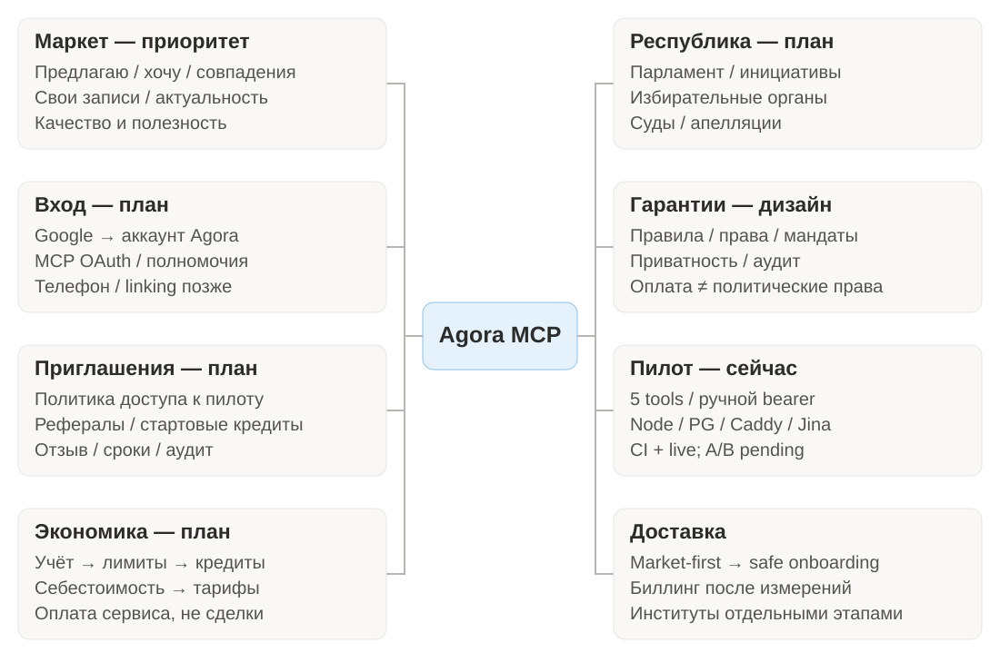
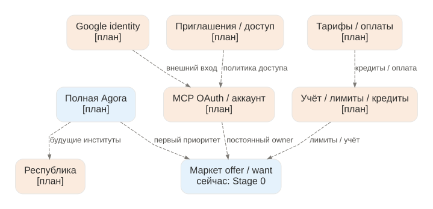
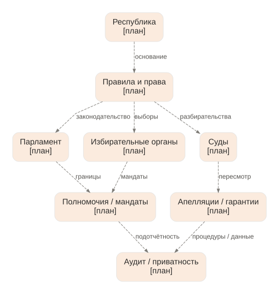
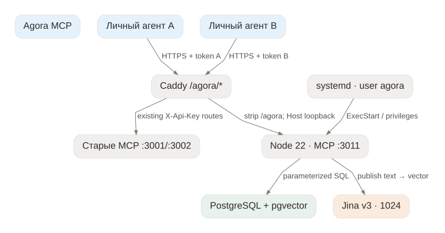
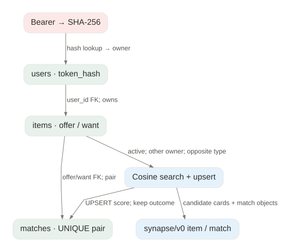
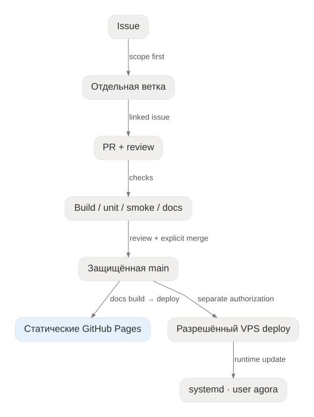
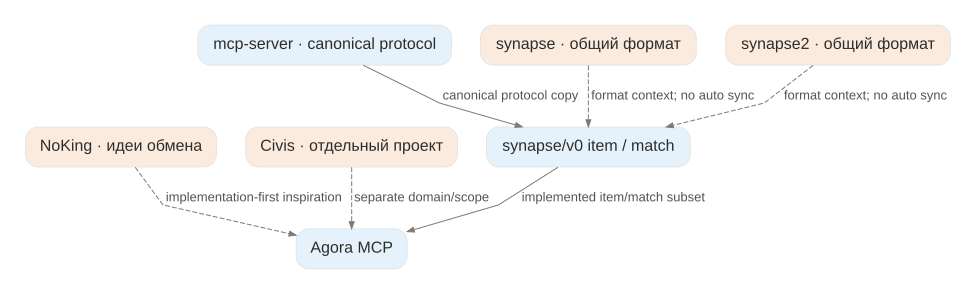

# Mindmap и граф всех связей проекта

Две разные модели: **mindmap** организует темы; **typed graph** описывает направленные связи и их источники. Это не количественный граф и не доказательство автоматического взаимодействия всех проектов.

## Mindmap

[Редактируемый Mermaid source](assets/mindmap.mmd) · [Graphviz source](assets/mindmap.dot)

## Целевая платформа — planned, не deployed runtime

Пунктир и метка **[план]** отличают будущие компоненты от уже работающего маркета. Связи не означают существующие endpoints или таблицы. [Задумка](vision.md), [доступ](identity-and-access.md), [экономика](economy.md).

## Республиканские институты — planned

Это направления будущего дизайна. Полномочия, гражданство и конституционная модель пока не определены; [ограничения и открытые вопросы](governance.md). Оплата не выдаёт политические права автоматически.

## Runtime / deployment

Старые backend 3001/3002 размещены рядом; их X-Api-Key не является Agora bearer token. Provider вызывается при publish, не при vector search.

## Данные и wire-format

## Разработка и публикация

Pages build не запускает приложение и не выполняет SSH/deploy на VPS.

## Экосистема

Пунктир — conceptual связь. Канонический protocol находится в mcp-server; копия в Agora. Описанные profile/contact/exchange не становятся доступными инструментами от наличия документа. Никакого auto sync, federation или A2A в runtime пока нет.

## Полный граф, не только overview

[JSON nodes/edges с типами, статусами и source](assets/project-graph.json) · [Полный editable DOT](assets/project-full.dot).

Полный dataset включает repository inventory, все относительные TypeScript imports и разрешаемые локальные Markdown links, runtime/schema/deployment/test workflow, planned-связи целевого доступа/экономики/институтов и явно ограниченные ecosystem relations. Не объявляет несуществующие интеграции. Generated SVG — читаемые выборки; HTML-сайт дополнительно показывает всю таблицу отношений с поиском и source links, включая file dependencies.

Regenerate: `python3 site/generate-maps.py` (Graphviz dot). Build проверяет ссылки и покрытие файлов/TS dependencies. Добавление source file или import требует регенерации; не править JSON/SVG раздельно.

Статусы: implemented — текущий runtime/schema; documented — зависимости/документы/workflow; prepared — Pages без подтверждения публикации; conceptual — контекст экосистемы; planned — будущие функции. Полный граф не превращает planned-связи в работающие интеграции.
